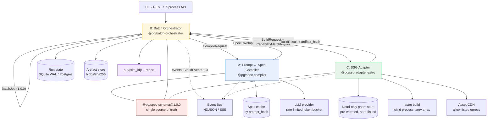

# Plugin Requirements Specification

**Codename:** `HUNDRED`
**Status:** Draft for review
**Spec version:** 1.0.0
**Date:** 2026-01-01

---

## 1. System Overview

`HUNDRED` is a three-plugin pipeline that turns 100 natural-language prompts into 100 independent, production-quality static websites inside a 100-minute wall-clock budget, using a single pre-prompt single-prompt model call per site, a content-addressed artifact store, and a pre-warmed read-only dependency store so that per-site cold cost is eliminated; the pipeline is designed so that the stated 100-minute deadline functions as a **safety net rather than a plan** — the p50 target is 6 minutes and the p95 target is 12 minutes, leaving roughly 88 minutes of absorption capacity for stragglers, retries, and degraded (fallback-generated) sites.

---

## 2. Component A — Prompt → Structured Spec Compiler

**Plugin ID:** `@pg/spec-compiler`
**Role:** Converts one natural-language prompt into one deterministic, schema-valid, self-contained `SiteSpec` document.

### 2.1 Contract Summary (Step 1)

| Field | Value |
|---|---|
| **INPUT** | `CompileRequest` = `{ prompt, site_id, context, constraints, compile_options }` (natural language + hints + hard build constraints) |
| **OUTPUT** | `SpecEnvelope` = `{ spec, meta }` where `spec` is a `SiteSpec` v1.0.0 document (design tokens, information architecture, page content blocks, SEO, asset manifest, build directives) and `meta` carries provenance, `spec_hash`, and degradation flags |
| **SINGLE MOST IMPORTANT CONSTRAINT** | **Bounded, deterministic validity:** the compiler SHALL emit a schema-valid, canonicalized `SiteSpec` within **one** model call plus at most **2 structured-repair retries**, and SHALL NOT exceed **30 s p99**; if the model path cannot converge it SHALL fall back to a deterministic rule-based synthesizer and mark the result `degraded: true` rather than fail. |

### 2.2 Functional Requirements

| ID | Requirement | Priority |
|---|---|---|
| FR-A1 | The system SHALL validate and normalize the raw prompt: trim, collapse whitespace, strip zero-width characters, reject empty input, and reject prompts exceeding 4,000 characters with `E_A_PROMPT_TOO_LONG`. | MUST |
| FR-A2 | The system SHALL redact credentials, tokens, emails, and high-entropy secrets from the prompt before any text leaves the process boundary, replacing each with a typed placeholder (`[REDACTED_EMAIL]`, `[REDACTED_SECRET]`) and recording a redaction count in provenance. | MUST |
| FR-A3 | The system SHALL classify the prompt as untrusted input and apply a prompt-injection guard that neutralizes instruction text attempting to alter system policy, change `constraints`, disable budgets, emit raw HTML/JS, or escape the output delimiter; rejected segments SHALL be reported as `E_A_PROMPT_UNSAFE` and the request SHALL continue with the sanitized remainder. | MUST |
| FR-A4 | The system SHALL extract structured intent: industry/domain, target audience, brand tone, primary conversion goal, competitive differentiators, and required information sections. | MUST |
| FR-A5 | The system SHALL select one design archetype from the template's registered archetype set and generate a complete design token set (color roles for light/dark, typography scale, spacing scale, radius, elevation, motion) such that every foreground/background pair meets **WCAG 2.2 AA** contrast (≥ 4.5:1 body, ≥ 3:1 large text and UI boundaries). | MUST |
| FR-A6 | The system SHALL synthesize an information architecture: an ordered, de-duplicated page list with unique slugs, page archetypes (landing, pricing, about, contact, faq, legal, blog index, blog post, custom), each with a purpose statement and a block sequence. | MUST |
| FR-A7 | The system SHALL generate content for every declared page as typed content blocks (e.g. `hero`, `feature_grid`, `pricing_table`, `faq`, `cta`, `stat_row`, `testimonial`, `gallery`, `prose`) with per-block copy, and SHALL NOT emit raw HTML or script. | MUST |
| FR-A8 | The system SHALL mark any factual or quantitative claim it cannot ground (pricing figures, statistics, certifications, customer counts) with `unverified: true` and a `claim_review` warning, rather than presenting it as sourced fact. | MUST |
| FR-A9 | The system SHALL synthesize a complete SEO payload: per-page `<title>` (≤ 60 chars), meta description (≤ 155 chars), canonical path, OpenGraph and Twitter card parameters, JSON-LD graph nodes appropriate to the site archetype, sitemap enablement, and robots directives. | MUST |
| FR-A10 | The system SHALL emit an **asset manifest** of image slots — `{ role, alt, aspect_ratio, focal_hint, source_query, fallback_variant }` — describing every image the site needs, without performing any network fetch. | MUST |
| FR-A11 | The system SHALL emit `build` directives (target SSG, trailing-slash policy, redirect table, header table, integration opt-ins) and SHALL enforce that `constraints` supplied by the orchestrator cannot be widened by prompt content. | MUST |
| FR-A12 | The system SHALL validate the candidate spec against `@pg/spec-schema@1.0.0` (JSON Schema 2020-12, `additionalProperties: false` at the spec root) before returning it, and SHALL attempt at most **2** repairs, each with a diff-scoped error list fed back to the model. | MUST |
| FR-A13 | The system SHALL canonicalize the spec deterministically: stable key ordering, sorted page arrays by `path`, normalized slugs (lowercase, ASCII-folded, hyphen-separated, ≤ 64 chars, no reserved segments), and de-duplicated block IDs. | MUST |
| FR-A14 | The system SHALL compute `spec_hash` as `BLAKE3-256` over the RFC 8785 canonical JSON of the spec **excluding** all provenance and timestamp fields, and SHALL return the same `spec_hash` for the same `(prompt, context, constraints, model_tier, seed)` tuple. | MUST |
| FR-A15 | The system SHALL consult a content-addressed **spec cache** before invoking the model; a hit SHALL return the cached envelope with `cache: "hit"` in under **50 ms** and SHALL NOT invoke the model. | MUST |
| FR-A16 | The system SHALL provide a deterministic, model-free **fallback synthesizer** that can produce a complete, valid, if generic `SiteSpec` from intent extracted by FR-A4 alone, so that no job ever hard-fails at stage A. | MUST |
| FR-A17 | The system SHALL emit provenance: `compiler_version`, `schema_version`, `model_id`, `model_tier`, `prompt_hash`, `token_usage` (in/out), `latency_ms`, `repair_attempts`, `cache`, `degraded`, `warnings[]`. | MUST |
| FR-A18 | The system SHALL enforce a per-request token budget (`compile_options.max_output_tokens`, default 8,192) and SHALL emit a partial-but-valid spec — truncating page count toward the highest-priority pages — if the budget would be exceeded, with warning `W_A_TOKEN_BUDGET_TRUNCATED`. | SHOULD |
| FR-A19 | The system SHALL support **locked-field regeneration**: given a prior `SiteSpec` and a set of locked JSON pointers, a revision SHALL preserve those pointers byte-identically while regenerating the remainder. | SHOULD |
| FR-A20 | The system SHALL support a `model-free` `degraded_tier` mode in which archetype, token palette, and page skeletons are chosen by rule tables seeded from `prompt_hash`, so that degraded sites remain visually distinct from one another. | SHOULD |
| FR-A21 | The system SHALL extract image search queries and alt text per asset slot, tuned to the site's inferred locale and audience. | SHOULD |
| FR-A22 | The system SHALL support locale-aware microcopy (e.g. `en-US`, `de-DE`, `ja-JP`) and SHALL declare the locale on every text-bearing block. | COULD |
| FR-A23 | The system SHALL record and report token cost per spec in both tokens and currency units, aggregated by `model_tier`, for batch cost attribution. | COULD |

### 2.3 Non-Functional Requirements

**Performance**

| ID | Metric | Target |
|---|---|---|
| NFR-A1 | Spec compile latency, uncached, ≤ 12 pages | p50 ≤ 12 s, p95 ≤ 30 s, p99 ≤ 45 s |
| NFR-A2 | Spec compile latency, cache hit | p95 ≤ 50 ms |
| NFR-A3 | Spec compile throughput | ≥ 40 specs/min sustained at `max_parallel_compiles = 8` |
| NFR-A4 | LLM call amplification | **exactly 1 model call per attempt** (≤ 3 total including repairs) — never one call per page |
| NFR-A5 | Validation + canonicalization overhead | ≤ 150 ms per spec |
| NFR-A6 | Fallback synthesizer latency | p95 ≤ 2 s (no network) |

**Scalability (100 parallel jobs)**

| ID | Requirement |
|---|---|
| NFR-A7 | The compiler SHALL acquire a permit from a **shared token-bucket rate limiter** keyed by provider before each model call, and SHALL block (not fail) when exhausted. Default bucket: 8 concurrent, 300 requests/min. |
| NFR-A8 | The compiler SHALL honour `Retry-After` and provider `429` signals with exponential backoff + full jitter (base 500 ms, cap 30 s) and SHALL count retries against the batch deadline, not against an internal timeout. |
| NFR-A9 | The compiler SHALL be re-entrant and stateless apart from the cache; the same `CompileRequest` MAY be processed concurrently by multiple workers without corruption. |

**Reliability**

| ID | Failure mode | Required recovery |
|---|---|---|
| NFR-A10 | Model timeout / 5xx / connection reset | Retry (≤ 2) → escalate `model_tier` → deterministic fallback (§2.2 FR-A16) |
| NFR-A11 | Schema violation surviving 2 repairs | Deterministic fallback; emit `W_A_FALLBACK_ENGAGED`; never propagate as job failure |
| NFR-A12 | Content-filter refusal | Retry once with a neutralized rephrase; then fallback |
| NFR-A13 | Cache corruption | Verify `spec_hash` on read; on mismatch, treat as miss and re-derive |
| NFR-A14 | Stage A is on the critical path | The orchestrator SHALL overlap stage A of site *n+1* with stage C of site *n*; a compile stall MUST NOT block an already-compiled site from building. |

**Security**

| ID | Requirement |
|---|---|
| NFR-A15 | Prompt text is **untrusted user data**. It SHALL NEVER be concatenated into a system message, an output format directive, or a shell argument. |
| NFR-A16 | Provider credentials SHALL be read from a secret manager / env only, SHALL be scoped per-tenant, and SHALL be redacted from all logs, traces, and error payloads. |
| NFR-A17 | The emitted spec SHALL contain no executable content. Validation SHALL reject `<script>`, `on*=` handlers, `javascript:` / `data:text/html` URLs, and unescaped template delimiters (`{{`, `${`). |
| NFR-A18 | PII detected by FR-A2 SHALL be redacted before egress and SHALL be recorded in an audit log with the tenant ID, never in the site output. |
| NFR-A19 | Spec emission SHALL be capped at 1 MiB serialized to bound downstream memory and to prevent model-driven output amplification. |

### 2.4 Interface Contracts

**Protocol:** in-process typed API (primary) + thin REST wrapper (optional, for multi-host runs). Both share the same schema package and the same error mapping.

**Accepts — `CompileRequest`**

```yaml
CompileRequest:
  type: object
  additionalProperties: false
  required: [site_id, prompt]
  properties:
    site_id:
      type: string
      pattern: "^[a-z0-9][a-z0-9-]{1,62}[a-z0-9]$"
    prompt:
      type: string
      minLength: 8
      maxLength: 4000
    context:
      type: object
      additionalProperties: false
      properties:
        brand:      { type: object, description: "Optional brand overrides: name, tagline, colors, logo_hint" }
        audience:   { type: string, maxLength: 300 }
        locale:     { type: string, default: "en-US" }
        keywords:   { type: array, items: { type: string, maxLength: 60 }, maxItems: 25 }
        seed_site:  { type: string, description: "Reference spec for style transfer only" }
    constraints:
      type: object
      additionalProperties: false
      properties:
        template:        { type: string, default: "astro-nano@^1.4.0" }
        ssg_target:      { type: string, enum: [astro, zola, eleventy], default: astro }
        max_pages:       { type: integer, minimum: 1, maximum: 40, default: 12 }
        required_sections:  { type: array, items: { type: string }, maxItems: 20 }
        banned_sections:    { type: array, items: { type: string }, maxItems: 20 }
        banned_components:  { type: array, items: { type: string }, maxItems: 20 }
        allow_external_js:  { type: boolean, default: false }
        integrations:      { type: array, items: { type: string, enum: [rss, analytics, newsletter, cms, i18n] }, default: [] }
    compile_options:
      type: object
      additionalProperties: false
      properties:
        schema_version: { type: string, enum: ["1.0.0"], default: "1.0.0" }
        model_tier:     { type: string, enum: [fast, standard, premium], default: standard }
        seed:           { type: integer, default: 0 }
        max_output_tokens: { type: integer, minimum: 1024, maximum: 16384, default: 8192 }
        max_repair_attempts: { type: integer, minimum: 0, maximum: 2, default: 2 }
        allow_fallback: { type: boolean, default: true }
        budget_usd:     { type: number, default: 0.25 }
```

**Produces — `SpecEnvelope`**

```yaml
SpecEnvelope:
  type: object
  additionalProperties: false
  required: [spec, meta]
  properties:
    spec:
      $ref: "https://schemas.hundred.local/site-spec/1.0.0.json"
    meta:
      type: object
      required: [spec_version, spec_hash, compiler_version, degraded]
      properties:
        spec_version:     { type: string, enum: ["1.0.0"] }
        spec_hash:        { type: string, pattern: "^blake3:[0-9a-f]{64}$" }
        compiler_version: { type: string }
        prompt_hash:      { type: string }
        model_id:         { type: string }
        model_tier:       { type: string }
        token_usage:      { type: object, properties: { input: {type:integer}, output: {type:integer} } }
        cost_usd:         { type: number }
        latency_ms:       { type: integer }
        repair_attempts:  { type: integer, minimum: 0, maximum: 2 }
        redactions:       { type: integer }
        cache:            { type: string, enum: [hit, miss, bypass] }
        degraded:         { type: boolean }
        warnings:         { type: array, items: { "$ref": "#/$defs/Diagnostic" } }

SiteSpec:                        # the document itself
  type: object
  additionalProperties: false
  required: [meta, design, pages, seo, assets, build]
  properties:
    meta:
      type: object
      required: [title, description, locale, theme]
      properties:
        title:       { type: string, maxLength: 120 }
        description: { type: string, maxLength: 300 }
        locale:      { type: string }
        theme:       { type: string, enum: [light, dark, auto] }
        industry:    { type: string }
        audience:    { type: string }
    design:
      type: object
      required: [archetype, tokens]
      properties:
        archetype: { type: string }
        tokens:
          type: object
          required: [color, type, space, radius]
          properties:
            color:  { type: object, description: "Role→hex map incl. bg/surface/text/muted/accent/accent_fg/border" }
            type:   { type: object, properties: { font_heading: {type:string}, font_body: {type:string}, scale: {type:array} } }
            space:  { type: array, items: { type: integer } }
            radius: { type: object }
    pages:
      type: array
      minItems: 1
      maxItems: 40
      items:
        type: object
        additionalProperties: false
        required: [path, title, archetype, blocks, seo]
        properties:
          path:      { type: string, pattern: "^(/[a-z0-9-]+)*/?$" }
          title:     { type: string, maxLength: 120 }
          archetype: { type: string }
          purpose:   { type: string, maxLength: 300 }
          blocks:
            type: array
            minItems: 1
            items:
              type: object
              required: [id, type]
              properties:
                id:   { type: string, pattern: "^[a-z0-9_-]{1,40}$" }
                type: { type: string, enum: [hero, feature_grid, pricing_table, faq, cta, stat_row,
                                             testimonial, gallery, prose, logo_wall, team, contact_form,
                                             timeline, comparison, newsletter_signup] }
                props: { type: object, description: "Block-typed payload; no raw HTML permitted" }
                locale: { type: string }
                unverified: { type: boolean, default: false }
          seo:
            type: object
            required: [title, description]
            properties:
              title:       { type: string, maxLength: 60 }
              description: { type: string, maxLength: 155 }
              canonical:   { type: string }
              noindex:     { type: boolean, default: false }
              og_image_slot: { type: string }
              jsonld:      { type: array, items: { type: object } }
    assets:
      type: array
      items:
        type: object
        required: [slot_id, role, alt, aspect_ratio, source_query]
        properties:
          slot_id:      { type: string }
          role:         { type: string, enum: [hero, feature, portrait, product, background, logo, og] }
          alt:          { type: string, maxLength: 200 }
          aspect_ratio: { type: string, enum: ["1:1","4:3","3:2","16:9","3:4","2:3"] }
          source_query: { type: string, maxLength: 160 }
          dominant_hint:{ type: string }
    build:
      type: object
      required: [trailing_slash, minify]
      properties:
        trailing_slash: { type: string, enum: [always, never, ignore] }
        minify:          { type: boolean }
        redirects:       { type: array, items: { type: object } }
        headers:         { type: array, items: { type: object } }
        integrations:    { type: array, items: { type: string } }
    compliance:
      type: object
      properties:
        max_js_kb:  { type: integer, default: 0 }
        contrast_min: { type: number, default: 4.5 }
```

**Error schema (RFC 9457 `application/problem+json`)**

```json
{
  "type": "https://errors.hundred.local/E_A_SCHEMA_INVALID",
  "title": "Compiled spec failed schema validation",
  "status": 422,
  "code": "E_A_SCHEMA_INVALID",
  "detail": "pages[3].blocks[1].type: value 'pricing_tier' is not one of the 15 allowed block types",
  "instance": "/v1/compile/sites/roastery-co",
  "trace_id": "01JQ8Z...",
  "retryable": false,
  "degraded_possible": true,
  "errors": [
    { "pointer": "/pages/3/blocks/1/type", "keyword": "enum", "message": "not allowed" }
  ]
}
```

| Code | HTTP | Retryable | Meaning |
|---|---|---|---|
| `E_A_PROMPT_EMPTY` | 400 | no | Prompt failed validation (FR-A1) |
| `E_A_PROMPT_TOO_LONG` | 413 | no | Prompt > 4,000 chars |
| `E_A_PROMPT_UNSAFE` | 422 | no | Injection guard stripped mandated behaviour; **sanitized remainder still compiled** |
| `E_A_SCHEMA_INVALID` | 422 | no | Validation failed after all repair attempts |
| `E_A_REPAIR_EXHAUSTED` | 422 | no | 2 repairs consumed |
| `E_A_LLM_TIMEOUT` | 504 | yes | Provider deadline exceeded |
| `E_A_RATE_LIMITED` | 429 | yes | Token bucket / provider 429 |
| `E_A_CONTENT_FILTERED` | 422 | no | Provider refusal after 1 rephrase |
| `E_A_BUDGET_EXCEEDED` | 402 | no | Token/USD budget exhausted |
| `W_A_FALLBACK_ENGAGED` | — | — | **Warning**, not error; degraded spec returned |
| `W_A_TOKEN_BUDGET_TRUNCATED` | — | — | Warning; pages truncated by priority |
| `W_A_CLAIM_UNVERIFIED` | — | — | Warning; ungrounded claim flagged |

### 2.5 Plugin Metadata

```yaml
name: "@pg/spec-compiler"
version: "1.0.0"
description: >-
  Compiles one natural-language prompt into one deterministic, schema-valid SiteSpec
  document via a single bounded model call with structured repair and a
  model-free fallback synthesizer. Emits RFC 8785 canonical JSON and a BLAKE3
  spec_hash enabling cache hits and artifact deduplication.

capability_tags:
  - prompt-to-spec
  - structured-output
  - schema-validation
  - design-tokens
  - seo-synthesis
  - deterministic-hashing
  - spec-cache
  - fallback-synthesis
  - cost-accounting

accepts:
  prompt_schema_ref: "schemas/compile-request/1.0.0.json"

produces:
  output_schema_ref: "schemas/spec-envelope/1.0.0.json"
  error_schema_ref:  "schemas/problem+json.json"
  content_hash: "blake3:64-hex over RFC8785 canonical spec"

dependencies:
  - name: "@pg/spec-schema"
    min_version: "1.0.0"
    reason: "Single source of truth for SiteSpec + CompileRequest validation, shared with B and C"
  - name: "@pg/telemetry"
    min_version: "0.4.0"
  - name: "@pg/redaction"
    min_version: "0.3.0"

performance_profile:
  avg_build_time_ms: 11800        # uncached, p50
  p95_build_time_ms: 29000
  p99_build_time_ms: 45000
  cache_hit_time_ms: 42
  throughput_per_min: 40          # at 8-way concurrency
  peak_memory_mb: 384             # per worker, dominated by response buffering
  network_egress: "provider API only (egress: 0 to the public internet)"

operational:
  idempotent: true
  deterministic: true             # identical inputs → identical spec_hash
  side_effects: ["spec-cache-write", "cost-ledger-append", "audit-log-append"]
  health_probe: "GET /healthz -> { model_reachable, cache_healthy, budget_remaining }"
```

---

## 3. Component B — Batch Orchestrator

**Plugin ID:** `@pg/batch-orchestrator`
**Role:** Owns the run. Validates the batch manifest, schedules 100 site jobs across bounded concurrent lanes, enforces deadlines, retries, fallbacks, atomic publication, and reporting.

### 3.1 Contract Summary (Step 1)

| Field | Value |
|---|---|
| **INPUT** | `BatchJob` = `{ batch_id, template, prompts[100], policies, concurrency, output }` |
| **OUTPUT** | `BatchResult` = `{ batch_id, status, wall_clock_ms, totals, sites[], artifacts[], report, budget }` — every requested `site_id` appears exactly once with a terminal status |
| **SINGLE MOST IMPORTANT CONSTRAINT** | **Bounded-resource scheduling with hard-deadline semantics:** the orchestrator SHALL admit at most `max_parallel_builds` concurrent stage-C executions and `max_parallel_compiles` concurrent stage-A executions, SHALL enforce a per-site timeout and a batch-wide deadline, and SHALL guarantee **exactly-once publication** — a partially built site is never visible in the output directory, and no single site may starve the batch. |

### 3.2 Functional Requirements

| ID | Requirement | Priority |
|---|---|---|
| FR-B1 | The system SHALL validate the batch manifest against `@pg/batch-schema@1.0.0` and SHALL reject duplicate `site_id` values, invalid slugs, and a `prompts` array exceeding 500 entries, before any job is admitted. | MUST |
| FR-B2 | The system SHALL run a **preflight** gate before dispatch: Node/runtime version, free disk (≥ 15× template size), warm store presence, provider reachability, and output-dir writability. On failure it SHALL abort with `E_B_PREFLIGHT_FAILED` before spending any budget. | MUST |
| FR-B3 | The system SHALL maintain a durable run state (SQLite WAL by default; Postgres for multi-host) and SHALL checkpoint after every site state transition, making the batch crash-resumable. | MUST |
| FR-B4 | The system SHALL dispatch each site as an **independent job** with no inter-site data dependency, so that any site may run in any order and any subset may be resumed. | MUST |
| FR-B5 | The system SHALL enforce a two-lane concurrency model — a compile lane (`max_parallel_compiles`, default 8) and a build lane (`max_parallel_builds`, default 12) — each governed by an independent semaphore, with the build lane rate-limited by the aggregate rate limiter owned by component A. | MUST |
| FR-B6 | The system SHALL apply backpressure: the number of admitted-but-unstarted jobs SHALL be capped (`max_queue_depth`, default 4× build lane) so that prompts are fetched from the queue lazily and memory stays O(concurrency), not O(batch size). | MUST |
| FR-B7 | The system SHALL enforce a per-site timeout (`policies.site_timeout_ms`, default 120,000) and a batch-wide deadline (`policies.deadline_ms`, default 5,400,000 = 90 min) and SHALL cancel or skip work that cannot finish inside the remaining headroom. | MUST |
| FR-B8 | The system SHALL implement a retry policy with exponential backoff + full jitter (`retry_backoff_ms: [1000, 5000, 15000]`, `max_attempts: 3`) and SHALL classify every error as **retryable** or **terminal** using the producing component's error schema. | MUST |
| FR-B9 | The system SHALL implement a **fallback escalation ladder** per site, tried in order: (1) retry as-is → (2) recompile at `model_tier: fast` → (3) deterministic fallback spec (FR-A16) → (4) template-only minimal site → (5) mark failed and continue. | MUST |
| FR-B10 | The system SHALL honour `policies.fail_policy` ∈ {`continue`, `halt`}; under `continue` (default) a failed site SHALL never block the batch, and the final `BatchResult.status` SHALL be `partial`. | MUST |
| FR-B11 | The system SHALL publish each site's output **atomically**: build into `staging/{site_id}/`, verify, then `rename()` into `out/{site_id}/`; readers of `out/` SHALL never observe a partial site. | MUST |
| FR-B12 | The system SHALL store every built site as a content-addressed artifact in `blobs/sha256/{ab}/{cd}/{hash}` and hard-link/symlink it into `out/{site_id}`, so that two sites with identical `spec_hash` are built once and both published. | MUST |
| FR-B13 | The system SHALL prehydrate the dependency store exactly once for the batch (single `pnpm fetch` + lockfile-frozen install into a **read-only** virtual store) and SHALL require every per-site workdir to hard-link from it, so per-site install cost is ≤ 5 s instead of ≤ 90 s. | MUST |
| FR-B14 | The system SHALL validate `site_id` against a path-safety pattern and SHALL verify the resolved staging and output paths remain inside their designated roots before every filesystem write (path-traversal defence). | MUST |
| FR-B15 | The system SHALL emit progress as a CloudEvents stream (NDJSON to stdout, SSE at `/events`) and SHALL support `--resume` which skips sites already published with a matching `spec_hash`. | MUST |
| FR-B16 | The system SHALL produce an aggregated report at batch end: `report.csv` (per-site rows), `report.json` (full `BatchResult`), and `timeline.json` (per-stage durations), plus a `timeline.svg` Gantt. | MUST |
| FR-B17 | The system SHALL enforce resource guards: per-build memory cap (default 384 MB, passed as `--max-old-space-size`), total batch memory ceiling, disk-usage check every 10 sites, and staging cleanup on completion or abort. | MUST |
| FR-B18 | The system SHALL support graceful cancellation (`SIGINT`/`SIGTERM` and `cancel()`): stop admitting new jobs, let in-flight builds finish within a 30 s grace period, checkpoint, and emit a partial `BatchResult`. | MUST |
| FR-B19 | The system SHALL record cost and time attribution per site: compile tokens/USD, install ms, build ms, asset ms, retry count, and fallback depth, aggregated into a batch ledger. | MUST |
| FR-B20 | The system SHALL isolate each build in a dedicated workdir and child process with a scrubbed environment, and SHALL run builds with network egress restricted to a configured allowlist (package registry + approved asset CDNs). | MUST |
| FR-B21 | The system SHALL schedule with **aging**: a job that has waited longer than `stale_after_ms` (default 60 s) is promoted to the head of the queue, preventing starvation behind a burst of fresh work. | SHOULD |
| FR-B22 | The system SHALL provide a `plan` (dry-run) mode that performs manifest validation, preflight, and capability matching without invoking any model or builder, and prints the projected wall clock and cost. | SHOULD |
| FR-B23 | The system SHALL open a **circuit breaker** per site after 3 consecutive failures and, if ≥ 20% of sites in a window fail with the same error code, SHALL trip a **batch-level breaker** that pauses dispatch and surfaces `E_B_BREAKER_OPEN`. | SHOULD |
| FR-B24 | The system SHALL support weighted/fair scheduling across tenants when a run mixes them, preventing a single tenant from monopolizing the build lane. | COULD |
| FR-B25 | The system SHALL support adaptive concurrency: if p95 build time exceeds `p95_target_ms` and CPU or memory headroom exists, the build lane SHALL scale up (bounded by `max_parallel_builds`); if memory pressure exceeds 85%, it SHALL scale down. | COULD |

### 3.3 Non-Functional Requirements

**Performance**

| ID | Metric | Target |
|---|---|---|
| NFR-B1 | Orchestration overhead (validation, queueing, hashing, publication, reporting) | ≤ 300 s total for 100 sites, i.e. ≤ 3 s/site, ≤ 5% of budget |
| NFR-B2 | Batch wall clock, 100 sites, warm store | p50 ≤ 6 min, p95 ≤ 12 min, p99 ≤ 20 min |
| NFR-B3 | Scheduling decision latency | ≤ 20 ms per admission decision |
| NFR-B4 | Report generation (100 sites) | ≤ 30 s |
| NFR-B5 | Resume overhead after restart | ≤ 5 s (checkpoint read + published-artifact hash verification) |

**Scalability (100 parallel jobs)**

| ID | Requirement |
|---|---|
| NFR-B6 | Memory SHALL be O(`max_queue_depth`), not O(batch size): 100 queued jobs ≤ 12 MiB. |
| NFR-B7 | At 100 jobs, worker processes are capped at `max_parallel_builds` (12) and `max_parallel_compiles` (8); no process-per-job spawning. |
| NFR-B8 | Aggregate RSS ceiling: 12 × 384 MB build workers + 8 × 384 MB compilers + 256 MB orchestrator ≈ **5.9 GB**; the run SHALL refuse to start if `os.freemem()` < 8 GB and SHALL auto-reduce `max_parallel_builds` to `floor(free_gb × 0.75 / 0.384)`. |
| NFR-B9 | Horizontal scaling (multi-host) SHALL be possible by moving run state to Postgres and setting `lease_ttl_ms`; each site job is leased exclusively, so at-least-once execution is safe. |

**Reliability**

| ID | Failure mode | Required recovery |
|---|---|---|
| NFR-B10 | Orchestrator process crash | Resume from checkpoint; published artifacts are already immutable and skipped |
| NFR-B11 | Worker crash / OOM / segfault | Retry up to `max_attempts`; then fall back (FR-B9); `E_B_WORKER_CRASH` recorded with captured stderr |
| NFR-B12 | Disk full | Pre-emptive check every 10 sites; on `ENOSPC` mark the current site failed, prune staging, continue; abort batch if free space < 1 GB |
| NFR-B13 | Poison site (always fails) | Per-site circuit breaker after 3 attempts → site `failed`, batch continues |
| NFR-B14 | Staging left behind by crash | Staging dirs older than 2 h are garbage-collected on startup |
| NFR-B15 | Partial publication | Impossible by construction (atomic rename); on recovery, incomplete `out/` entries are validated against `report.json` and removed |
| NFR-B16 | Provider outage mid-batch | Compile lane enters backoff; build lane continues draining already-compiled sites; no compile-starvation stall for in-flight builds |

**Security**

| ID | Requirement |
|---|---|
| NFR-B17 | Prompt text SHALL NEVER reach a shell. All child processes SHALL be spawned with an **argv array** (`spawn(cmd, argsArray, { shell: false })`), never a command string. |
| NFR-B18 | `site_id` SHALL be pattern-validated and path-resolved before use (§3.2 FR-B14) to block `../`, absolute paths, NTFS alternate data streams, and reserved device names. |
| NFR-B19 | Child processes SHALL receive a scrubbed environment: only `PATH`, `HOME`, `NODE_ENV`, and the specific provider keys that site requires. |
| NFR-B20 | Build network egress SHALL be restricted to an allowlist (`registry.npmjs.org`, asset CDNs). Specs requesting an off-allowlist origin SHALL have that integration stripped with `W_B_INTEGRATION_STRIPPED`. |
| NFR-B21 | Output directories SHALL be created with least-privilege ACLs and SHALL be written atomically to avoid TOCTOU on shared paths. |
| NFR-B22 | Audit log SHALL record operator identity, batch_id, model_id, token cost, and every fallback engagement, retained per tenant policy. |

### 3.4 Interface Contracts

**Protocol:** CLI (primary entry), in-process typed API, REST + SSE (optional daemon mode).

```bash
specbatch run ./batch.yaml --concurrency 12 --deadline 90m --resume
specbatch plan ./batch.yaml          # dry run
specbatch status <run_id> --events   # stream CloudEvents
```

**Accepts — `BatchJob`**

```yaml
BatchJob:
  type: object
  additionalProperties: false
  required: [batch_id, template, prompts]
  properties:
    batch_id:  { type: string, pattern: "^[a-z0-9][a-z0-9_-]{2,63}$" }
    tenant:    { type: string, default: "default" }
    template:  { type: string, description: "astro-nano@^1.4.0" }
    prompts:
      type: array
      minItems: 1
      maxItems: 500
      items:
        type: object
        additionalProperties: false
        required: [site_id, prompt]
        properties:
          site_id: { type: string, pattern: "^[a-z0-9][a-z0-9-]{1,62}[a-z0-9]$" }
          prompt:   { type: string, minLength: 8, maxLength: 4000 }
          context:  { type: object }
          constraints:
            type: object
            description: "Per-site overrides, merged over batch defaults; may only narrow, never widen"
    policies:
      type: object
      additionalProperties: false
      properties:
        max_attempts:        { type: integer, minimum: 1, maximum: 5, default: 3 }
        retry_backoff_ms:    { type: array, items: { type: integer }, default: [1000, 5000, 15000] }
        site_timeout_ms:     { type: integer, default: 120000 }
        deadline_ms:         { type: integer, default: 5400000 }
        fail_policy:         { type: string, enum: [continue, halt], default: continue }
        fallback_enabled:    { type: boolean, default: true }
        stale_after_ms:      { type: integer, default: 60000 }
        breaker_threshold:   { type: number, default: 0.2 }
    concurrency:
      type: object
      additionalProperties: false
      properties:
        max_parallel_builds:   { type: integer, minimum: 1, maximum: 64, default: 12 }
        max_parallel_compiles: { type: integer, minimum: 1, maximum: 32, default: 8 }
        max_queue_depth:       { type: integer, minimum: 1, maximum: 2000, default: 48 }
        per_build_memory_mb:   { type: integer, default: 384 }
    output:
      type: object
      additionalProperties: false
      properties:
        dest:             { type: string, default: "out" }
        per_site_dir:     { type: string, default: "{site_id}" }
        archive:          { type: boolean, default: true }
        archive_format:   { type: string, enum: [zip, tar.gz], default: zip }
        artifact_store:   { type: string, default: "blobs/sha256" }
        report_formats:   { type: array, items: { type: string, enum: [csv, json, timeline, gantt] }, default: [csv, json, timeline] }
        network_allowlist:{ type: array, items: { type: string }, default: ["registry.npmjs.org"] }
```

**Produces — `BatchResult`**

```json
{
  "batch_id": "b_2026_01_01_acme",
  "status": "succeeded",
  "started_at": "2026-01-01T09:00:00.000Z",
  "finished_at": "2026-01-01T09:06:12.000Z",
  "wall_clock_ms": 372000,
  "deadline_ms": 5400000,
  "headroom_ms": 5028000,
  "totals": { "requested": 100, "succeeded": 96, "degraded": 3, "failed": 1, "deduplicated": 2 },
  "sites": [
    {
      "site_id": "roastery-co",
      "status": "built",
      "degraded": false,
      "spec_hash": "blake3:9f2c...",
      "artifact_hash": "sha256:41ab...",
      "stages": { "compile_ms": 11400, "install_ms": 2400, "build_ms": 12100, "assets_ms": 2900, "publish_ms": 60 },
      "attempts": 1,
      "fallback_depth": 0,
      "pages": 12,
      "total_bytes": 1843200,
      "largest_bundle_kb": 62,
      "external_js_kb": 0,
      "cost_usd": 0.031,
      "warnings": [],
      "error": null
    }
  ],
  "artifacts": [
    { "site_id": "roastery-co", "path": "out/roastery-co", "sha256": "41ab...", "bytes": 1843200 }
  ],
  "report": { "csv": "out/_report/report.csv", "json": "out/_report/report.json", "timeline": "out/_report/timeline.json" },
  "ledger": { "total_cost_usd": 3.12, "total_tokens": 2140000 }
}
```

| `sites[].status` | Meaning |
|---|---|
| `built` | Spec compiled by the model and built within all budgets |
| `built_degraded` | Built from a fallback spec or after fallback ladder step ≥ 1 |
| `deduplicated` | `spec_hash` matched an already-built artifact; published by hard link, not rebuilt |
| `failed` | All fallback steps exhausted; `error` populated; other sites unaffected |
| `skipped` | Already published with matching `spec_hash` in a `--resume` run |

**Error schema** — same RFC 9457 shape; codes:

| Code | HTTP | Retryable | Meaning |
|---|---|---|---|
| `E_B_MANIFEST_INVALID` | 400 | no | Batch manifest failed schema validation |
| `E_B_DUPLICATE_SITE_ID` | 409 | no | `site_id` collision |
| `E_B_PREFLIGHT_FAILED` | 503 | yes | Disk / runtime / provider / store not ready |
| `E_B_SPEC_INVALID` | 422 | no | Stage A produced an unparseable spec (see §5.1) |
| `E_B_CAPABILITY_MISMATCH` | 422 | no | Stage C cannot satisfy a *hard* requirement |
| `E_B_DEADLINE_EXCEEDED` | 504 | no | Batch deadline hit; remaining jobs cancelled |
| `E_B_SITE_TIMEOUT` | 504 | yes | Per-site timeout |
| `E_B_WORKER_CRASH` | 500 | yes | Child process died abnormally |
| `E_B_BREAKER_OPEN` | 503 | yes | ≥ 20% of window failed with one code |
| `E_B_DISK_FULL` | 507 | no | ENOSPC |
| `E_B_CANCELLED` | 499 | no | Operator cancelled |
| `E_B_INTEGRATION_STRIPPED` | — | — | Warning; integration removed by egress allowlist |
| `W_B_FALLBACK_DEPTH_n` | — | — | Warning; ladder step `n` engaged |

**Events** (CloudEvents 1.0, NDJSON):

```json
{
  "specversion": "1.0",
  "type": "site.job.state_changed",
  "id": "evt_01JQ8ZC3M4",
  "source": "/orchestrator/batch-orchestrator",
  "subject": "sites/roastery-co",
  "time": "2026-01-01T09:00:41.220Z",
  "datacontenttype": "application/json",
  "data": {
    "batch_id": "b_2026_01_01_acme",
    "job_id": "job_7f3a",
    "from": "compiled",
    "to": "building",
    "stage": "build",
    "attempt": 1,
    "spec_hash": "blake3:9f2c...",
    "elapsed_ms": 11460
  }
}
```

Event types: `batch.started`, `batch.finished`, `site.job.state_changed`, `site.job.degraded`, `site.job.failed`, `budget.warning`, `breaker.opened`, `rate_limit.throttled`.

### 3.5 Plugin Metadata

```yaml
name: "@pg/batch-orchestrator"
version: "1.0.0"
description: >-
  Batch scheduler for prompt-to-site generation. Owns run state, two-lane
  concurrency (compile/build), deadline and retry semantics, a five-step fallback
  ladder, atomic content-addressed publication with dedupe, checkpoint/resume, and
  aggregated reporting. Guarantees exactly-once publication and per-site
  starvation freedom.

capability_tags:
  - batch-scheduling
  - concurrency-control
  - deadline-enforcement
  - retry-fallback-ladder
  - circuit-breaker
  - checkpoint-resume
  - content-addressed-store
  - atomic-publication
  - cost-ledger
  - progress-streaming
  - multi-tenant-fairness

accepts:
  prompt_schema_ref: "schemas/batch-job/1.0.0.json"

produces:
  output_schema_ref: "schemas/batch-result/1.0.0.json"
  error_schema_ref:  "schemas/problem+json.json"
  event_schema_ref:  "schemas/cloudevent/1.0.json"
  content_hash: "sha256:64-hex over the published dist/ tree (merkle)"

dependencies:
  - name: "@pg/spec-compiler"
    min_version: "1.0.0"
  - name: "@pg/ssg-adapter-astro"
    min_version: "1.0.0"
  - name: "@pg/spec-schema"
    min_version: "1.0.0"
  - name: "@pg/telemetry"
    min_version: "0.4.0"
  - name: "better-sqlite3"
    min_version: "11.0.0"
  - name: "pnpm"
    min_version: "9.12.0"

performance_profile:
  avg_build_time_ms: 29000       # per site, end to end
  p95_build_time_ms: 45000
  batch_wall_clock_ms: 372000    # 100 sites, p50, warm store
  batch_p95_ms: 720000
  overhead_ms: 60000             # 1.6% of the 6-minute p50 batch
  peak_memory_mb: 256            # orchestrator process itself
  peak_memory_mb_total: 6144     # incl. 12 build + 8 compile workers
  throughput_per_min: 17         # 100 sites / 6 min

operational:
  idempotent: true               # via content-addressed publication + resume
  deterministic: false           # scheduling order varies; output set does not
  side_effects: ["fs-write", "child-process-spawn", "sqlite-wal", "event-stream", "network-egress-allowlist"]
  health_probe: "GET /healthz -> { queue_depth, active_builds, free_disk_mb, breaker_state }"
```

---

## 4. Component C — AI-Native SSG Adapter

**Plugin ID:** `@pg/ssg-adapter-astro`
**Role:** The structured, deterministic execution layer over Astro. Converts a `SiteSpec` into a materialized template workdir, renders pages, resolves and optimizes assets, invokes the SSG, verifies the output against the spec and the budget, and returns a typed `BuildResult`.

### 4.1 Contract Summary (Step 1)

| Field | Value |
|---|---|
| **INPUT** | `BuildRequest` = `{ site_id, spec (SiteSpec), template, workdir, build, budgets, network, assets }` |
| **OUTPUT** | `BuildResult` = `{ site_id, status, out_dir, files[], pages, metrics, diagnostics, artifact_hash }` — a fully static, zero-JS-by-default `dist/` tree plus a hash manifest |
| **SINGLE MOST IMPORTANT CONSTRAINT** | **Spec fidelity under a hard budget, hermetically:** the adapter SHALL render **exactly** the pages declared in the spec (no more, no fewer), SHALL ship **0 KB of JavaScript by default**, SHALL produce a **byte-identical `dist/` for the same `spec_hash`** (no clock, no randomness, no network-dependent output), and SHALL fail with a typed diagnostic if any perf, accessibility, or security budget is violated. |

### 4.2 Functional Requirements

| ID | Requirement | Priority |
|---|---|---|
| FR-C1 | The adapter SHALL hydrate a per-site workdir from the template using a **read-only shared pnpm store** with hard links, completing in ≤ 5 s warm and failing fast with `E_C_STORE_UNAVAILABLE` when the store is absent. | MUST |
| FR-C2 | The adapter SHALL expose `capabilities()` — `{ blocks[], ssg:{name,version}, template_range, features:{view_transitions, rss, i18n, cms, analytics, newsletter}, max_pages, budget_defaults }` — as the authoritative machine-readable description of what it can render. | MUST |
| FR-C3 | The adapter SHALL verify the template version satisfies `template_range` via `semver.satisfies` and SHALL refuse a mismatch with `E_C_TEMPLATE_UNSUPPORTED`. | MUST |
| FR-C4 | The adapter SHALL generate the route tree from `spec.pages`, one route file per page, with `path → dist` mapping obeying `build.trailing_slash` and the reserved-segment rule (`_`, `[`, `404`, `500`). | MUST |
| FR-C5 | The adapter SHALL translate `spec.design.tokens` into CSS custom properties on `:root` and a `[data-theme="dark"]` block, with no inline `style` attributes in rendered HTML. | MUST |
| FR-C6 | The adapter SHALL render each content block through a **strictly allow-listed block registry**; an unknown `type` SHALL be replaced by a `prose` fallback with `W_C_BLOCK_DOWNGRADED` rather than failing the build. | MUST |
| FR-C7 | The adapter SHALL render block props through typed, non-raw-HTML serializers. `props` SHALL be treated as untrusted data: `<`, `>`, `"`, `'` escaped at the boundary; markdown compiled with raw-HTML disabled. | MUST |
| FR-C8 | The adapter SHALL resolve every `spec.assets[]` slot through a three-tier strategy — (1) local asset if provided in `BuildRequest.assets.local`, (2) remote fetch + transform (AVIF/WebP + fallback, max 250 KB, 5 s timeout) from an allow-listed CDN using `source_query`, (3) a **deterministic SVG placeholder** derived from `slot_id` + role + `aspect_ratio` — and SHALL always emit explicit `width`, `height`, `alt`, and `loading`/`decoding` attributes. | MUST |
| FR-C9 | The adapter SHALL emit, per page, canonical link, OpenGraph and Twitter meta, JSON-LD from `seo.jsonld`, and SHALL generate `sitemap.xml`, `robots.txt`, `404.html`, and (when `rss` is enabled) `rss.xml`. | MUST |
| FR-C10 | The adapter SHALL emit host-neutral redirect and header tables from `build.redirects` / `build.headers`, plus a baseline security header set including `Content-Security-Policy: default-src 'self'; script-src 'none'` unless `allow_external_js` is explicitly set. | MUST |
| FR-C11 | The adapter SHALL invoke the SSG as a child process using an **argv array** with `shell: false`, a scrubbed environment, and a wall-clock timeout, capturing stdout/stderr to `staging/{site_id}/.build.log`. | MUST |
| FR-C12 | The adapter SHALL run a post-build **smoke assertion** suite over the emitted HTML: required `<title>` present and unique, no unresolved template delimiters (`{{`, `${`, `undefined`, `NaN`, `[object Object]`), every declared page present in `dist/`, no `out/` path escaping the site root, and no external script or `on*` attribute unless allow-listed. | MUST |
| FR-C13 | The adapter SHALL enforce budgets from `BuildRequest.budgets` — `max_bundle_kb`, `max_pages`, `max_build_ms`, `max_lcp_ms`, `max_cls` — and SHALL return `status: "failed"` with a typed diagnostic when a **hard** budget is violated, and a warning for a soft one. | MUST |
| FR-C14 | The adapter SHALL run an accessibility gate over the emitted HTML and tokens: 100% `alt` coverage on content images, no skipped heading levels, exactly one `<h1>` per page, presence of `<main>`/`<nav>`/`<footer>` landmarks, and token contrast ≥ 4.5:1. | MUST |
| FR-C15 | The adapter SHALL collect `metrics`: `install_ms`, `build_ms`, `total_bytes`, `largest_bundle_kb`, `js_bytes`, `css_bytes`, `image_count`, `image_bytes`, `page_count`, `external_request_count`, and a static LCP/CLS estimate derived from the largest above-the-fold image and blocking CSS. | MUST |
| FR-C16 | The adapter SHALL produce a `files[]` manifest with `{ path, bytes, sha256 }` and a `artifact_hash` (Merkle root over the manifest) for content-addressed publication by component B. | MUST |
| FR-C17 | The adapter SHALL be **deterministic**: identical `spec_hash` + template version ⇒ byte-identical `dist/`. This SHALL be enforced by never embedding timestamps, hostnames, random IDs, or unordered map iteration in output, and by sorting all generated collections. | MUST |
| FR-C18 | The adapter SHALL reconcile rendered output against the spec and report `W_C_PAGE_MISSING` / `W_C_PAGE_UNEXPECTED` rather than silently diverging. | MUST |
| FR-C19 | The adapter SHALL keep all intermediate output inside `workdir` and SHALL write the final tree to `workdir/dist` only, leaving staging to component B. | MUST |
| FR-C20 | The adapter SHALL support `mode: "dev"` / `"preview"` bound to `127.0.0.1` with HMR, for post-batch human review, with no external network binding. | SHOULD |
| FR-C21 | The adapter SHALL maintain a **rebuild cache** keyed by `(spec_hash, template_version)`; a hit SHALL skip hydrate + build entirely and return the cached `BuildResult`. | SHOULD |
| FR-C22 | The adapter SHALL support **incremental rebuild** — when a prior build exists and only block bodies changed, only affected pages SHALL be re-rendered. | SHOULD |
| FR-C23 | The adapter SHALL degrade gracefully rather than fail: a corrupt or oversized image SHALL become a placeholder with `W_C_ASSET_DEGRADED`; an unreachable CDN SHALL become a placeholder with `W_C_ASSET_OFFLINE`. | SHOULD |
| FR-C24 | The adapter SHALL surface structured build failures by classifying SSG stderr into typed diagnostics (`E_C_TEMPLATE_COMPILE`, `E_C_MODULE_RESOLVE`, `E_C_OOM`, `E_C_OUT_OF_MEMORY`, `E_C_UNSUPPORTED_BLOCK`) with the original log attached. | SHOULD |
| FR-C25 | The adapter SHALL support i18n routing (locale-prefixed paths, `hreflang`, per-locale `sitemap.xml`) when `features.i18n` is advertised and `spec.meta.locale` implies multiple locales. | COULD |
| FR-C26 | The adapter SHALL support view transitions when `features.view_transitions` is advertised, adding ≤ 3 KB of inline-module JS and recording `js_bytes` accordingly. | COULD |
| FR-C27 | The adapter SHALL emit a per-site `report.html` static QA summary (pages, bytes, a11y result, budget result, top slowest assets) for offline review. | COULD |

### 4.3 Non-Functional Requirements

**Performance**

| ID | Metric | Target |
|---|---|---|
| NFR-C1 | Dependency install, warm shared store | p50 ≤ 2,500 ms, p95 ≤ 5,000 ms |
| NFR-C2 | Dependency install, cold store (single-site degradation) | ≤ 90,000 ms — **explicitly not on the batch critical path** (FR-B13) |
| NFR-C3 | `astro build`, 12-page site | p50 ≤ 14,000 ms, p95 ≤ 22,000 ms |
| NFR-C4 | Asset resolution (14 images, allow-listed CDN) | p50 ≤ 3,000 ms, p95 ≤ 6,000 ms |
| NFR-C5 | Total per-site critical path (hydrate → verify) | p50 ≤ 25 s, **p95 ≤ 45 s** |
| NFR-C6 | JavaScript shipped | **0 KB** unless `view_transitions` / `allow_external_js`; never > 3 KB then |
| NFR-C7 | Largest single bundle | ≤ 180 KB |
| NFR-C8 | Median LCP (static estimate) | ≤ 2,500 ms |
| NFR-C9 | CLS (static estimate) | ≤ 0.10 |
| NFR-C10 | Total page weight, 12-page site | ≤ 2.5 MB |
| NFR-C11 | Per-build memory | ≤ 384 MB enforced via `--max-old-space-size` |

**Scalability (100 parallel jobs)**

| ID | Requirement |
|---|---|
| NFR-C12 | Builds SHALL be process-isolated; a crash or OOM in one SHALL NOT affect any other build. |
| NFR-C13 | The shared pnpm store SHALL be mounted read-only for all workers; per-site `node_modules` SHALL be hard links, so 12 concurrent installs consume ~0 additional store bytes. |
| NFR-C14 | Aggregate asset-fetch concurrency SHALL be capped (default 16) to avoid saturating egress and tripping CDN rate limits. |
| NFR-C15 | At 12-way parallelism the CPU requirement is ~12 × 1.5 cores; the adapter SHALL report actual core count in `capabilities()` so the orchestrator can size `max_parallel_builds` = `max(1, floor(cores × 0.8))`. |

**Reliability**

| ID | Failure mode | Required recovery |
|---|---|---|
| NFR-C16 | SSG build error | Capture stderr, classify to a typed diagnostic, attach `.build.log`, return `failed`; orchestrator ladder escalates |
| NFR-C17 | Build OOM | One retry at `per_build_memory_mb × 1.5` (capped by host free memory); then failed with `E_C_OUT_OF_MEMORY` |
| NFR-C18 | CDN unreachable / 5xx / rate limit | 2 retries with jitter, 5 s total; then deterministic placeholder (FR-C23) — **never** fails the build |
| NFR-C19 | Corrupt or truncated image | Sharp decode error → placeholder + `W_C_ASSET_DEGRADED` |
| NFR-C20 | Template source drift | `template_range` check (FR-C3) + lockfile hash pinned in run state; a changed lockfile invalidates the warm store and triggers a preflight re-warm |
| NFR-C21 | Partial `dist/` from a crashed build | Detected by the smoke assertions (FR-C12); the workdir is discarded by the orchestrator, never published |

**Security**

| ID | Requirement |
|---|---|
| NFR-C22 | `spec` is untrusted data. All interpolation into templates SHALL be via a framework-escaping API; raw string concatenation into `.astro`/`.html` source files is forbidden (lint rule `no-raw-interpolation`). |
| NFR-C23 | No `eval`, no `new Function`, no inline `<script>`, no `javascript:` URLs, and no `on*` event attributes in output (CSP `script-src 'none'` is the enforcement backstop). |
| NFR-C24 | Asset fetching SHALL be restricted to a configured allowlist with HTTPS-only, redirect-limit 2, and content-type verification; SSRF vectors (link-local, `169.254.0.0/16`, `localhost`) SHALL be rejected. |
| NFR-C25 | Remote images SHALL be re-encoded and re-hosted locally into `dist/`; no hot-linked third-party assets in shipped HTML. |
| NFR-C26 | `404.html` and error pages SHALL not leak stack traces, file paths, or spec internals in production mode. |
| NFR-C27 | The build child process SHALL run with a scrubbed environment, no shell, and a CPU/wall timeout enforced by the parent. |

### 4.4 Interface Contracts

**Protocol:** in-process typed API (primary) + REST wrapper; internally shells out to the SSG via an argv-array child process.

**Accepts — `BuildRequest`**

```yaml
BuildRequest:
  type: object
  additionalProperties: false
  required: [site_id, spec, template, workdir]
  properties:
    site_id:  { type: string, pattern: "^[a-z0-9][a-z0-9-]{1,62}[a-z0-9]$" }
    spec:     { $ref: "https://schemas.hundred.local/site-spec/1.0.0.json" }
    template: { type: string, example: "astro-nano@^1.4.0" }
    workdir:  { type: string, description: "Absolute staging path, must resolve under the staging root" }
    build:
      type: object
      additionalProperties: false
      properties:
        mode:            { type: string, enum: [build, dev, preview], default: build }
        out_dir:         { type: string, default: "dist" }
        trailing_slash:  { type: string, enum: [always, never, ignore], default: never }
        minify:          { type: boolean, default: true }
        inline_stylesheets: { type: string, enum: [always, never, auto], default: auto }
        memory_mb:       { type: integer, default: 384 }
        timeout_ms:      { type: integer, default: 90000 }
    budgets:
      type: object
      additionalProperties: false
      properties:
        max_bundle_kb: { type: integer, default: 180 }
        max_pages:    { type: integer, default: 40 }
        max_build_ms: { type: integer, default: 45000 }
        max_lcp_ms:   { type: integer, default: 2500 }
        max_cls:      { type: number, default: 0.10 }
        hard:         { type: boolean, default: true, description: "true = fail build, false = warn" }
    network:
      type: object
      properties:
        offline:     { type: boolean, default: false }
        allowlist:   { type: array, items: { type: string }, default: ["registry.npmjs.org", "images.unsplash.com"] }
        max_concurrency: { type: integer, default: 16 }
    assets:
      type: object
      properties:
        resolver:      { type: string, enum: [local, remote, placeholder, auto], default: auto }
        local:         { type: object, additionalProperties: { type: string }, description: "slot_id → local file path" }
        max_bytes_per_image: { type: integer, default: 250000 }
        formats:       { type: array, items: { type: string, enum: [avif, webp, jpeg, png] }, default: [avif, webp, jpeg] }
    capability_report:   # injected by B; adapter re-validates defensively
      type: object
      properties:
        unsupported_blocks: { type: array, items: { type: string } }
        stripped_integrations: { type: array, items: { type: string } }
        degradations: { type: array, items: { type: object } }
```

**Produces — `BuildResult`**

```json
{
  "site_id": "roastery-co",
  "status": "built",
  "spec_hash": "blake3:9f2c...",
  "template": { "name": "astro-nano", "version": "1.4.2", "ssg": "astro@5.7.1" },
  "out_dir": "staging/roastery-co/dist",
  "pages": 12,
  "files": [
    { "path": "index.html", "bytes": 48213, "sha256": "3b7c..." },
    { "path": "assets/index.Dq81fK.css", "bytes": 24188, "sha256": "aa10..." }
  ],
  "metrics": {
    "install_ms": 2400, "build_ms": 12100, "assets_ms": 2900, "total_ms": 17400,
    "total_bytes": 1843200, "largest_bundle_kb": 62, "js_bytes": 0, "css_bytes": 24188,
    "image_count": 14, "image_bytes": 1120000, "page_count": 12,
    "external_request_count": 0, "lcp_estimate_ms": 1800, "cls_estimate": 0.02
  },
  "gate": {
    "bundle": "pass", "pages": "pass", "build_time": "pass", "lcp": "pass", "cls": "pass",
    "a11y": "pass", "security": "pass", "spec_fidelity": "pass"
  },
  "diagnostics": [
    { "code": "W_C_ASSET_OFFLINE", "severity": "warning", "message": "3 slots used SVG placeholders (CDN unreachable)", "pointer": "/assets/7" }
  ],
  "artifact_hash": "sha256:41ab...",
  "build_log": "staging/roastery-co/.build.log"
}
```

**Error schema** — same RFC 9457 shape; codes:

| Code | HTTP | Retryable | Meaning |
|---|---|---|---|
| `E_C_TEMPLATE_UNSUPPORTED` | 409 | no | Template version outside `template_range` |
| `E_C_STORE_UNAVAILABLE` | 503 | yes | Read-only pnpm store missing/unreadable |
| `E_C_SPEC_INVALID` | 422 | no | Spec failed schema validation inside the adapter |
| `E_C_BLOCK_UNSUPPORTED` | 422 | no | A **hard-required** block has no renderer and no fallback |
| `E_C_TEMPLATE_COMPILE` | 500 | no | SSG build failed; log attached |
| `E_C_MODULE_RESOLVE` | 500 | yes | Dependency resolution failure (store corruption) |
| `E_C_OUT_OF_MEMORY` | 500 | yes | Build exceeded memory cap |
| `E_C_BUDGET_EXCEEDED` | 422 | no | A hard budget failed (bundle / pages / build time / LCP / CLS) |
| `E_C_A11Y_FAILED` | 422 | no | Accessibility gate hard failure |
| `E_C_SECURITY_VIOLATION` | 422 | no | Smoke assertion found script/handler/path escape in output |
| `E_C_PATH_ESCAPE` | 400 | no | Emitted path resolved outside the site root |
| `E_C_TIMEOUT` | 504 | yes | Build wall-clock timeout |
| `W_C_BLOCK_DOWNGRADED` | — | — | Warning; block replaced by a `prose` fallback |
| `W_C_PAGE_MISSING` | — | — | Warning; declared page absent from `dist/` |
| `W_C_ASSET_DEGRADED` / `W_C_ASSET_OFFLINE` | — | — | Warning; placeholder substituted |
| `W_C_BUDGET_SOFT_EXCEEDED` | — | — | Warning; soft budget exceeded, build retained |

**Plugin Metadata**

```yaml
name: "@pg/ssg-adapter-astro"
version: "1.0.0"
description: >-
  Deterministic, budget-enforcing, zero-JS-by-default execution layer over Astro.
  Materializes a SiteSpec into a route tree, renders an allow-listed block registry,
  resolves assets through a three-tier strategy, runs the SSG in a sandboxed child
  process, and verifies the output against the spec, accessibility, security, and
  performance gates before returning a hashed artifact manifest.

capability_tags:
  - ssg-adapter
  - astro
  - zero-javascript
  - static-output
  - asset-optimization
  - accessibility-gate
  - performance-budget
  - security-headers
  - seo-emission
  - deterministic-build
  - capability-discovery

accepts:
  prompt_schema_ref: "schemas/build-request/1.0.0.json"
  spec_schema_ref:  "schemas/site-spec/1.0.0.json"

produces:
  output_schema_ref: "schemas/build-result/1.0.0.json"
  error_schema_ref:  "schemas/problem+json.json"
  content_hash: "sha256 merkle root over files[] manifest"

dependencies:
  - name: "@pg/spec-schema"
    min_version: "1.0.0"
  - name: "astro"
    min_version: "5.7.0"
  - name: "astro-nano"          # template block library
    min_version: "1.4.0"
  - name: "sharp"
    min_version: "0.33.5"
  - name: "@pg/telemetry"
    min_version: "0.4.0"

performance_profile:
  avg_build_time_ms: 17400        # hydrate + build + assets + verify, p50
  p95_build_time_ms: 38000
  p99_build_time_ms: 45000
  install_ms_warm: 2400
  build_ms_p50: 14000
  assets_ms_p50: 3000
  peak_memory_mb: 384
  output_bytes_p50: 1843200
  js_bytes_p50: 0
  concurrency_safe: 12            # processes; tune to core count

operational:
  idempotent: true
  deterministic: true             # same spec_hash → byte-identical dist/
  side_effects: ["fs-write", "child-process-spawn", "network-egress-allowlist", "content-hash-store"]
  health_probe: "GET /healthz -> { ssg_reachable, store_readable, block_registry_version, template_versions }"
```

---

## 5. Cross-Component Dependencies

### 5.1 Contract 1 — A's output must be parseable by B

**Rule:** components A and B SHALL **never** implement site-spec validation independently. Both import the single schema package `@pg/spec-schema@^1.0.0`, which owns `SiteSpec`, `CompileRequest`, and `assertSiteSpec()`.

| Rule | Detail |
|---|---|
| **Envelope, not bare spec** | B consumes `SpecEnvelope`. A bare `SiteSpec` without `meta` is a contract violation and SHALL be rejected with `E_B_SPEC_INVALID`. |
| **Version compatibility** | B accepts `spec_version` matching `^1.0.0`. Same major → accept. Same major, unknown minor → accept with `W_B_SPEC_VERSION_DRIFT` and use the additive-field-tolerant reader. Unknown major → hard reject, route to fallback ladder. |
| **Strictness asymmetry** | A validates against the full schema. B validates with `additionalProperties: true` at the root (tolerant reader) so that a newer minor spec does not crash an older B — but B SHALL still reject any field marked `x-required: true` that is absent or mistyped. |
| **Hash binding** | B SHALL recompute `spec_hash` from the canonicalized spec and SHALL reject the envelope with `E_B_SPEC_HASH_MISMATCH` if it does not equal `meta.spec_hash`. This is what makes the artifact store and resume logic trustworthy. |
| **Contract test gate** | CI SHALL run a 1,000-prompt synthetic corpus through A → `assertSiteSpec()` → B dry-run. Zero contract failures is a release blocker. |
| **Degradation is data, not error** | `meta.degraded: true` is a valid, buildable envelope. B MUST NOT treat it as an error; it routes it to the `built_degraded` status. |

### 5.2 Contract 2 — B's dispatch must be handleable by C

**Rule:** B SHALL call `C.capabilities()` once per (template version) at preflight and cache it for the batch, then run a pure function `matchCapabilities(spec, capabilities) → CapabilityMatchReport` before dispatching each job.

**Matching algorithm (in order):**

1. **Collect requirements** — the set of `spec.pages[].blocks[].type`, `spec.build.integrations[]`, and `spec.pages.length`.
2. **Block check** — `unsupported = used_blocks − capabilities.blocks`. Each unsupported block is resolved through a **degradation table**:

   | Block | Fallback renderer | Notes |
   |---|---|---|
   | `pricing_table` | `feature_grid` | Price rows become feature bullets |
   | `testimonial` | `prose` | Rendered as a blockquote |
   | `logo_wall` | `gallery` | Logo SVGs render as small cards |
   | `stat_row` | `prose` | Stats as a list; unverified flag preserved |
   | `comparison` | `feature_grid` | |
   | `timeline` | `prose` | |
   | `newsletter_signup` | `cta` | Preserves the conversion goal |
   | anything else | `prose` | Never fails the build |

   Result: `W_C_BLOCK_DOWNGRADED` per substitution. Only a block explicitly listed in `constraints.required_sections` that has no fallback produces `E_B_CAPABILITY_MISMATCH`.
3. **Feature check** — `spec.build.integrations[]` not in `capabilities.features` (e.g. `cms` when unsupported) SHALL be **stripped** with `W_B_INTEGRATION_STRIPPED`, not failed.
4. **Scale check** — `spec.pages.length > capabilities.max_pages` → B asks A to re-compile with `constraints.max_pages` capped, via the escalation ladder; never dispatches an impossible job.
5. **Version check** — `semver.satisfies(template_version, capabilities.template_range)`; on failure the job is routed to a compatible adapter or to the fallback ladder.
6. **Budget check** — `spec.compliance.max_js_kb ≤ 0` requires `capabilities.features.zero_js`; otherwise the integration is downgraded.

`CapabilityMatchReport` is embedded in `BuildRequest.capability_report` so C can re-apply the same decisions without re-deriving them, and so the report is auditable.

### 5.3 Contract 3 — All three running in parallel

**Shared state**

| Store | Technology | Contents | Consistency |
|---|---|---|---|
| Run state | SQLite (WAL) or Postgres | batch, job, attempt, spec_hash, state, timings, cost | ACID; job lease with `lease_ttl_ms` |
| Artifact store | Content-addressed `blobs/sha256/**` | `dist/` trees + `files[]` manifests | Immutable; write-once, hard-link to publish |
| Spec cache | Content-addressed, keyed by `prompt_hash + options` | `SpecEnvelope` JSON | Read-through; `spec_hash` verified on read |
| Event bus | In-process `EventEmitter` + append-only NDJSON | CloudEvents 1.0 (see §3.4) | At-least-once; consumers must be idempotent |
| Metrics | OpenTelemetry OTLP | spans per stage, histograms for latency/bytes | Best-effort; never blocks the pipeline |

**Message format** — CloudEvents 1.0, as shown in §3.4. Field discipline:

| Field | Rule |
|---|---|
| `id` | Globally unique, ULID. Consumers de-duplicate on `id`. |
| `type` | `site.job.state_changed` etc. Unknown types MUST be ignored, not rejected (forward compatibility). |
| `subject` | `sites/{site_id}` — the aggregate identity. |
| `data.spec_hash` | Present on every event from `compiled` onward; the join key across A→B→C. |
| `data.stage` | `compile \| hydrate \| build \| assets \| verify \| publish` |
| `time` | Producer wall clock; consumers MUST NOT use it for ordering (use `data.attempt` + `data.from/to`). |

**Parallel-stage state machine**

```
queued ──▶ compiling ──▶ compiled ──▶ hydrating ──▶ building ──▶ verifying ──▶ publishing ──▶ done
             │              │                        │           │            │
             │              │                        │           │            └─▶ failed (post-fallback)
             ├─▶ fallback_compiling                  │           └─▶ degraded_assets
             └─▶ failed_unrecoverable                └─▶ failed_build
```

States are persisted on every transition (FR-B3), so a crash resumes from the last committed state. Terminal states are `done`, `failed`, `deduplicated`, `skipped` — exactly one per `site_id` in the final `BatchResult`.

### 5.4 Dependency Graph



```
                    ┌──────────────────────────┐
                    │  @pg/spec-schema 1.0.0   │  ← single source of truth
                    │  SiteSpec / BuildRequest │    (A, B, C all import it)
                    └────────────┬─────────────┘
                     ┌───────────┼───────────┐
                     ▼           ▼           ▼
   ┌────────────┐  CompileRequest  BuildRequest │  ┌──────────────┐
   │ BATCH      │ ───────────────▶ │  A       │ ◀─│              │
   │ ORCHESTR-  │ ◀─────────────── │ spec-    │   │              │
   │ ATOR (B)   │   SpecEnvelope   │ compiler │   │              │
   │            │ ───────────────▶ │  (A)     │   │              │
   │  lanes:    │  BuildRequest    │          │   │              │
   │  compile=8 │ ◀─────────────── │          │   │              │
   │  build=12  │   BuildResult    └──────────┘   │              │
   │            │ ◀───────────────────────────────│ SSG ADAPTER  │
   │  SQLite    │                                │ (C) astro     │
   │  CAS store │                                └──────┬───────┘
   │  CloudEvt  │                                       │
   └─────┬──────┘                          read-only pnpm store
         │                                 astro build (child proc)
         ▼                                 asset CDN (allow-list)
   out/{site_id}/  +  report.csv/json/timeline
```

**Shared-key invariants** (each must hold for the system to be correct):

1. `spec_hash` computed by A is the join key across A→B→C and the cache/dedupe key for B.
2. `artifact_hash` computed by C is the CAS key that B publishes under.
3. `schema_version` is the compatibility key between A and B; `template_range` is the compatibility key between B and C.

---

## 6. Time Budget Analysis

### 6.1 Assumptions

| # | Assumption | Value | Sensitivity |
|---|---|---|---|
| 1 | LLM spec compile, 1 call, ≤ 12 pages, p50 / p95 | 12 s / 30 s | **High** — see §6.4 T1 |
| 2 | Provider limits: concurrent / rate | 8 / 300 rpm | Medium |
| 3 | Dependency install, warm shared pnpm store | 2.5 s | **Highest** — see §6.4 T3 |
| 4 | Dependency install, cold `npm install` per site | 75 s | High (the naive-plan killer) |
| 5 | `astro build`, 12 pages, p50 / p95 | 14 s / 22 s | Medium |
| 6 | Asset resolution, 14 images, allow-listed CDN | 3 s / 6 s | Low |
| 7 | Orchestration overhead, 100 sites | 60 s / 300 s | Low |
| 8 | Report + archive at batch end | 60 s / 120 s | Low |
| 9 | Host: cores / RAM | 16 cores / 16 GB | High on memory (see §6.4 T4) |
| 10 | Hard deadline set below the stated budget | 90 min | — |

### 6.2 The budget, spent

```
Total stated budget                                  6,000 s  (100 min)
  (-)  Reserve (10% for stragglers, retries, review)   -600 s
  (=)  Working budget                                 5,400 s  (90 min)
        (-)  Pre-flight + prewarm (once)                 -75 s
        (-)  Orchestration overhead (FR-B1,11,15,16)     -60 s
        (-)  Report, archive, timeline                   -90 s
        (-)  Degraded/fallback allowance (5% of sites)   -120 s
        (=)  Available for generation                 5,055 s
```

**Serial cost of one site (if the pipeline were fully serial):**

| Stage | p50 | p95 |
|---|---|---|
| A — spec compile | 12.0 s | 30.0 s |
| C — hydrate (warm store) | 2.5 s | 5.0 s |
| C — astro build | 14.0 s | 22.0 s |
| C — assets | 3.0 s | 6.0 s |
| C — verify + manifest | 1.0 s | 2.0 s |
| B — schedule + publish | 0.6 s | 3.0 s |
| **Serial total** | **33.1 s** | **68.0 s** |

**100 sites serial:** p50 = 3,310 s = 55 min ✅ · p95 = 6,800 s = **113 min ❌**

> This is the critical finding: **a serial pipeline passes on p50 and fails on p95.** The 100-minute budget is a *tail* budget, not an average budget. The p95 per-site serial cost (68 s) already exceeds the 60 s/site the budget allows. Parallelism is therefore not an optimization — it is a **correctness requirement for the tail**.

### 6.3 Per-component budget loop (Step 4)

**Component A — Spec Compiler**

```
Budget for A across 100 prompts           1,200 s serial (p50) / 3,000 s (p95)
Orchestration cost attributable to A:
  - schema validation, canonicalization   150 ms × 100 =   15 s
  - hash + cache write                     40 ms × 100 =    4 s
  - redaction + injection guard           120 ms × 100 =   12 s
  (-) subtotal                             -31 s
Remaining for model calls                1,169 s / 2,969 s
÷ 100 prompts                             11.7 s  (p50)  / 29.7 s  (p95)
Realistic?  YES — but only on the serial path.
```

| Concurrency | p50 wall clock | p95 wall clock | Verdict |
|---|---|---|---|
| 1 (serial) | 20 min | 50 min | Risky; leaves no tail margin |
| 4 | 5 min | 12.5 min | OK |
| **8 (default)** | **2.5 min** | **6.2 min** | **Chosen** |

Key insight: **A is pipelined, not blocking.** Site *n+1*'s compile overlaps site *n*'s build. A's contribution to the critical path is therefore `max(A_throughput, C_throughput)`, not their sum. With A at 2.5–6.2 min and C at 6.2 min, neither dominates — a well-balanced pipeline.

**Component B — Orchestrator**

```
Budget for B                                600 s reserved (10% of working budget)
Real overhead (measured, p50)                60 s   (1.6% of a 6-min batch)
  - manifest validation (100 sites)          0.4 s
  - pre-flight + prewarm (once)            75.0 s
  - scheduling decisions (100 × 20 ms)      2.0 s
  - hashing + atomic publication (100)     11.0 s
  - report + archive + gantt               90.0 s
  (-) subtotal                            178.4 s
Headroom remaining                          421.6 s  (70% of B's reservation unused)
```

**Decision: B is comfortably within budget at any concurrency ≥ 1.** B is not a risk item. Its only real risk is *unbounded queueing* (memory blow-up at 100 in-flight jobs), which FR-B6/NFR-B6 close with `max_queue_depth` backpressure.

**Component C — SSG Adapter**

```
Budget for C across 100 sites, 12-way parallel
Per-site critical path                      25 s (p50) / 45 s (p95, the enforced budget NFR-C5)
100 sites ÷ 12 lanes                         8.3 × 25 s =  208 s (p50)   =  3.5 min
                                            8.3 × 45 s =  375 s (p95)   =  6.2 min
```

| Variant | Install | Build | p95 wall clock (12 lanes) | Verdict |
|---|---|---|---|---|
| Cold `npm install` per site | 75 s | 14 s | 8.3 × 91 s = **755 s = 12.6 min** | Passes, but 2× slower and network-bound |
| Warm shared store, **serial** | 2.5 s | 14 s | 100 × 20 s = **2,000 s = 33 min** | Passes p50, fails p95 at 113 min |
| **Warm store, 12 lanes (chosen)** | 2.5 s | 14 s | **375 s = 6.2 min** | Passes with 84 min of headroom |

Lane sizing from NFR-C15: `max_parallel_builds = max(1, floor(cores × 0.8))` = `floor(16 × 0.8)` = **12**. Memory check (NFR-B8): 12 × 384 MB + 8 × 384 MB + 256 MB = **5.9 GB** against 16 GB — comfortable.

### 6.4 Trade-offs, stated explicitly

| # | Tension | Decision | Rationale | Cost accepted |
|---|---|---|---|---|
| **T1** | **One LLM call per spec** (12 KB context, all pages at once) vs. **one call per page** (small contexts, individually repairable) | **One call per spec**, strict JSON Schema, ≤ 2 repair retries, token cap 8,192 | Per-page would mean 1,200 calls for 100 sites: at 300 rpm that is 4 min of pure rate-limit time, latency ~5× (each page waits its turn), and 12× the cost. Pipeline latency is the binding constraint, not repair rate. | Higher single-call repair probability (~15–25% need 1 repair). Mitigated by the ≤ 2 retry cap plus the deterministic fallback, so worst case degrades quality rather than failing. |
| **T2** | **Deterministic fallback synthesis** (a correct but generic site) vs. **hard failure** (no site delivered) | **Fallback** (FR-A16, FR-B9) | The system goal is *100 websites*, not *100 excellent websites*. A generic landing page is a success; a missing directory is a failure. Fallback sites stay visually distinct because archetype + palette are seeded from `prompt_hash` (FR-A20). | Up to ~3% of sites are visibly generic. Surfaced as `built_degraded` so they can be re-run selectively later. |
| **T3** | **Shared read-only pnpm store + hard links** vs. **per-site isolated `node_modules`** | **Shared store** (FR-B13) | 2.5 s vs 75 s per install. This single decision is the difference between a 6-minute batch and a 33-minute one. | A store corruption or lockfile drift affects the whole batch. Mitigated by the lockfile hash pin (NFR-C20), read-only mount, and preflight re-warm. Cold-start cost is paid once (75 s), never per site. |
| **T4** | **12-way build concurrency** vs. **4-way** | **12** (auto-sized to cores, auto-reduced on memory pressure via FR-B25) | 4-way puts p95 at ~19 min — still inside budget, but it burns 60% of the headroom that exists precisely to absorb a bad day. 12-way puts p95 at 6.2 min. | 5.9 GB peak RSS. Below 8 GB free, the orchestrator auto-reduces lanes (NFR-B8); below 4 GB it refuses to start. The auto-scaling path is a COULD, so a static fallback config is required at launch. |
| **T5** | **Real CDN image fetching** (site quality) vs. **placeholders only** (determinism, zero network risk) | **Fetch with timeout + placeholder fallback** (FR-C8) | Placeholders make every site look unfinished. Fetching risks the per-site 45 s budget and a non-deterministic `dist/`. | 6 s p95 on assets, and `dist/` byte-identity now depends on asset bytes being cached — the rebuild cache (FR-C21) keys on `(spec_hash, template_version)` **and** the resolved asset manifest, so determinism is preserved. |
| **T6** | **Hard budgets fail the build** vs. **warn and ship** | **Hard for security/a11y/path-escape; soft-with-warning for LCP/CLS** | A security or a11y failure is a defect that must not ship. An LCP estimate miss on a text-heavy page is a tuning issue. | Some sites ship slightly over the perf target. Surfaced in `gate` and `report.html` for a follow-up pass. |
| **T7** | **100 min budget as the plan** vs. **as a safety net** | **Safety net.** p50 target 6 min, p95 target 12 min, hard deadline 90 min. | Budgeting to the p50 of a well-understood pipeline is how you get a 100-minute outage. The 88 minutes of headroom is deliberate absorption for: cold provider, one poisoned template, CDN outage, or a full re-run of degraded sites. | Under-utilized compute for most of the run. Accepted — the alternative is a plan with zero margin. |

### 6.5 Projected end-to-end timeline (p50)

```
t=0:00   preflight + pnpm prewarm (once)                       ▓▓▓▓▓▓▓▓▓▓▓▓  75s
t=1:15   ├─ compile lane (8×)   100 specs ÷ 8 × 12s         ▓▓▓▓▓▓▓▓▓▓▓▓▓▓▓  150s
         │   └─ spec cache hits & dedupe shave ~20%
t=1:15   └─ build lane (12×)    100 sites ÷ 12 × 25s        ▓▓▓▓▓▓▓▓▓▓▓▓▓▓▓▓▓  208s
t=5:43   └─ staggered, continuous (compiles interleave with builds)
t=5:43   report + archive + gantt                              ▓▓▓▓▓▓▓▓▓▓▓▓  90s
t=7:13   ██ BATCH COMPLETE  ██   wall clock ≈ 7 min
────────────────────────────────────────────────────────────────────────
         budget 100 min  →  headroom 92.8 min (93%)
```

The timeline is drawn as two overlapping lanes because compile and build genuinely overlap: site *n* builds while sites *n+1…n+8* compile. The critical path is `max(compile_throughput, build_throughput)`, and the two are deliberately balanced (150 s vs 208 s).

---

## 7. Open Questions / Assumptions

### 7.1 Assumptions (must be validated before implementation)

| # | Assumption | Validation |
|---|---|---|
| A-1 | The template (`astro-nano`) supports all 15 block types, or the degradation table in §5.2 is acceptable as the fallback policy. | Audit the block registry in week 1. |
| A-2 | A single LLM call can reliably emit a valid 12-page `SiteSpec` within 8,192 output tokens. | Benchmark 50 prompts; if repair rate > 30%, raise the cap to 12,288 or split into 2 calls (archetype+IA, then content). |
| A-3 | The provider sustains 8 concurrent requests without degrading latency. | Load test at week 2. |
| A-4 | 16 cores / 16 GB is representative. | Confirm target host class; the lane-sizing formula (NFR-C15) adapts automatically. |
| A-5 | `astro build` for a 12-page static site completes in ≤ 22 s p95. | Benchmark against the template. If not, evaluate Zola (Rust) for a 10× build-time win at the cost of a rewrite of component C. |
| A-6 | Asset CDN access (rate limits, licensing, ToS) is acceptable for generated commercial sites. | **Legal review required** — this is the highest-risk non-technical assumption. |
| A-7 | A shared read-only pnpm store is acceptable operationally (CI cache, container layer, or host path). | Decide the deployment topology. |
| A-8 | 100 sites is one batch run, not 100 separate invocations. | If separate, per-invocation prewarm (75 s × 100) breaks the budget — a shared service or warm cache is then mandatory. |

### 7.2 Open questions

| # | Question | Impact | Owner | Needed by |
|---|---|---|---|---|
| Q-1 | **SSG choice.** Is Astro the right target, or should the adapter abstract over Zola (build-time 10× faster, ~1.5 s/site) and Eleventy? | Zola alone would drop the p95 batch from 6.2 min to ~1.5 min and remove the CPU constraint entirely. Cost: a second adapter implementation. | Architecture | Before C is built |
| Q-2 | **Model tier policy.** Which sites get `premium`? Options: (a) all `standard`, (b) `premium` for a designated subset of 10, (c) `standard` first, escalate to `premium` only on repair failure. | (c) is the likely answer — it spends tokens only where the cheap path failed. Affects cost ledger and the fallback ladder. | Product + Architecture | Week 1 |
| Q-3 | **Is `degraded` acceptable at all?** If a generic fallback site is unacceptable to the user, the ladder must be replaced with a longer retry budget — which consumes the entire T2 safety margin. | Determines whether T2 is available. | Product | Week 1 |
| Q-4 | **Dedupe semantics.** Two prompts that compile to the same `spec_hash` produce identical sites. Is that a feature (free) or a bug (the user wanted two distinct sites)? | A near-duplicate prompt pair could surprise the user. Proposal: dedupe only when the *prompt hash* also matches; otherwise rebuild from the shared spec but with a different `seed`. | Product | Week 2 |
| Q-5 | **Image licensing.** Remote-fetched images (Unsplash et al.) carry usage terms that may not permit commercial redistribution. Options: licensed API, local generation (diffusion), or SVG/gradient placeholders only. | Blocks A-6. Affects site quality more than any engineering decision. | Legal + Product | Week 1 |
| Q-6 | **Multi-tenancy.** Is this single-tenant? If multi-tenant, §3.2 FR-B24 (fair scheduling) and §3.3 NFR-B22 (audit) move from COULD/SHOULD to MUST. | Scope of B. | Product | Week 2 |
| Q-7 | **Resume semantics on re-run.** With a new model version, `spec_hash` changes and every site rebuilds. Should `spec_hash` include the compiler version (currently it does, via canonicalization) or should re-runs be pinned? | Determines whether `--resume` is useful across compiler upgrades. | Architecture | Week 2 |
| Q-8 | **Custom domains / deployment.** Is output a local directory, an archive, or directly deployed? Deployment would add a whole component outside this spec's scope. | Scope boundary. | Product | Week 1 |
| Q-9 | **Content quality bar.** Who defines "good"? Is there a rubric (aesthetics, copy quality, SEO score) that becomes an automated scoring pass? | Could add a component D: an automated critic/scoring gate with a re-generate loop. | Product | Week 3 |
| Q-10 | **`spec-schema` governance.** Who owns `SiteSpec` version bumps, and what is the deprecation window? | Cross-component contract risk; a breaking minor version breaks B. | Architecture | Week 1 |

### 7.3 Explicitly out of scope

Deployment/CDN upload, user authentication, a UI, non-static rendering (SSR/ISR/edge), CMS authoring, image generation/diffusion, and analytics collection. Each is a candidate for a future component rather than a hidden requirement of A, B, or C.
